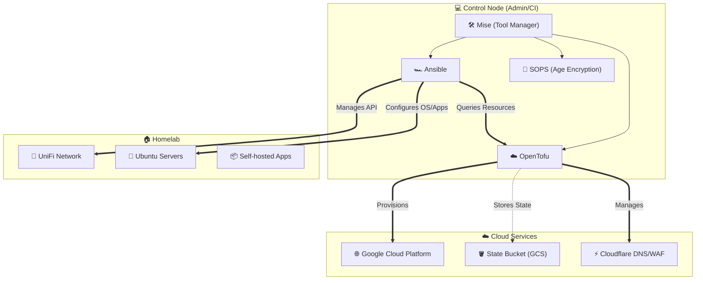

# 🏡 Homelab & Cloud Infrastructure GitOps

Welcome to the GitOps repository for managing Cloud (GCP, Cloudflare) and Homelab (Ubuntu Server, UniFi) infrastructure. This repository uses **OpenTofu** for infrastructure provisioning, **Ansible** for system configuration, **SOPS** with **age** for secrets management, and **Lefthook** to enforce quality and security guardrails.

---

## 🗺️ High-Level Architecture

The following diagram illustrates how the infrastructure and configuration components relate:



---

## 🛠️ Global Toolset

This repository pins tools globally in `.mise.toml` to ensure every administrator and CI agent runs the identical binary versions:

| Tool               | Version | Purpose                                                       |
| :----------------- | :------ | :------------------------------------------------------------ |
| **OpenTofu**       | `1.8`   | Declarative cloud and local resource provisioning             |
| **Ansible**        | `10`    | Idempotent software installation and configuration management |
| **SOPS**           | `3.9`   | File-level encryption/decryption of secrets                   |
| **Age**            | `1.2`   | Simple, modern, and secure tool for key generation            |
| **Lefthook**       | `1.10`  | Parallel pre-commit Git hooks for security and quality        |
| **Python**         | `3.12`  | Root runtimes for Ansible and scripting                       |
| **Ruff**           | `0.9`   | Lightning-fast Python linter and formatter                    |
| **ShellCheck**     | `0.10`  | Bash/shell script static analyzer                             |
| **Terraform-Docs** | `0.19`  | Automated markdown documentation for OpenTofu modules         |
| **Act**            | `0.2`   | Local execution of GitHub Actions workflows                   |
| **Git-Crypt**      | `0.7+`  | Transparent file-level encryption for sensitive docs/ tree    |

---

## 📋 Prerequisites

Before setting up the repository, ensure your control machine has the following dependencies:

1. **Operating System:** macOS (Apple Silicon or Intel) or Linux (Ubuntu, Debian, Fedora, Arch)
2. **Git:** `git` version `2.34+`
3. **Git-Crypt:** Required to view and edit encrypted documentation and backup artifacts under `docs/` and `backups/`.
   - Installation (macOS): `brew install git-crypt`
   - Installation (Linux/Debian): `sudo apt-get install git-crypt`
4. **Mise-cli:** Recommended for automated version management.
   - Installation (macOS): `brew install mise`
   - Installation (Linux): `curl https://mise.run | sh`

---

## 🚀 Quickstart

Get your local workspace up and running in under two minutes:

### Step 1: Clone and Run the Bootstrap Script

Run the automated bootstrap script to install Mise (if missing), run `mise install` to provision global tools, unlock encrypted documentation and backups (`docs/`, `backups/`) if your production GPG key is imported, generate a local secret keypair, and set up your Python virtual environment:

```bash
git clone https://github.com/jmollner/homelab-infra.git
cd homelab-infra
./scripts/bootstrap.sh
```

> [!NOTE]
> All designs and plans in `docs/` and backup archives in `backups/` are encrypted at rest using `git-crypt` with the production GPG key (`5EE1590FF82DC2A3829D224FAA73ACF495CC009D`). If `scripts/bootstrap.sh` does not detect your GPG key, import it and run `git-crypt unlock` manually.

### Step 2: Configure Your Shell Integration

Ensure `mise` is integrated with your terminal so the path resolves the pinned tools and automatically activates the Python environment when entering the workspace:

_For Zsh (~/.zshrc):_

```bash
echo 'eval "$(mise activate zsh)"' >> ~/.zshrc
source ~/.zshrc
```

_For Bash (~/.bashrc):_

```bash
echo 'eval "$(mise activate bash)"' >> ~/.bashrc
source ~/.bashrc
```

### Step 3: Configure Your SOPS Keys

Make sure your private age key location is set in your environment:

```bash
export SOPS_AGE_KEY_FILE="$HOME/.config/sops/age/keys.txt"
```

---

## 📁 Repository Directory Layout

The structure of the repository is modular and structured as follows:

```text
.
├── .github/                 # GitHub Actions workflows and templates
├── apps/                    # Code, Dockerfiles, or builds for self-hosted applications
├── backups/                 # Offline backups and recovery archives (git-crypt encrypted)
├── configuration/           # Ansible inventories, playbooks, and roles
│   ├── inventories/         # Environment inventories (production, testing)
│   ├── playbooks/           # Ansible master & domain playbooks
│   └── roles/               # Reusable Ansible configuration units
├── docs/                    # Architecture, design proposals, plans (git-crypt encrypted)
├── infrastructure/          # OpenTofu root and shared modules
│   ├── bootstrap/           # GCS storage buckets for remote states
│   ├── cloudflare/          # DNS, tunnels, and page routing
│   ├── gcp/                 # GCP compute, networks, and identities
│   └── homelab/             # Proxmox/VM provisionings and local networks
├── scripts/                 # Administration and git-hook helper scripts
└── secrets/                 # Decoy/CI keys and secrets guides
```

---

## 🤝 Contributing Guidelines

We enforce strict quality and security gates to maintain an exceptional and secure codebase:

### 1. Pre-Commit Hooks (Lefthook)

Lefthook is run automatically before every commit to protect the main branch from unencrypted secrets, lint failures, and formatting issues.

- To run hooks manually: `mise exec lefthook -- lefthook run pre-commit`

### 2. Conventional Commits

All commits must follow the **Conventional Commits** specification:

- `feat(scope): ...` for new features/resources
- `fix(scope): ...` for bug fixes
- `docs(scope): ...` for documentation updates
- `chore(scope): ...` for tooling and dependencies

### 3. AI Agent Instructions

If you are pair-programming with AI agents (such as Antigravity), they are bound by the strict operational rules located in `AGENTS.md`. Please do not bypass Git hooks using `--no-verify`.
