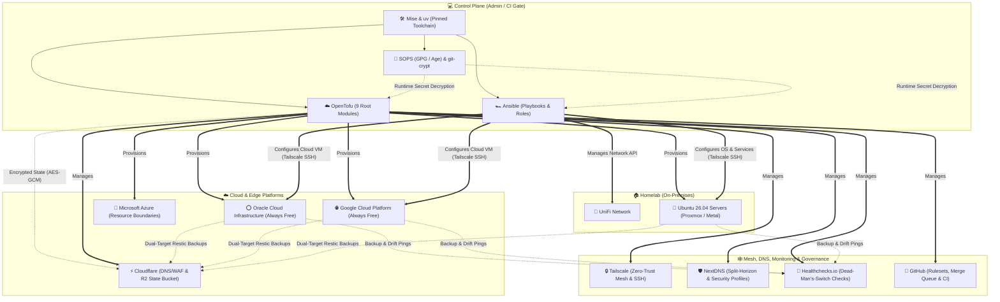

# 🏡 Homelab & Cloud Infrastructure GitOps

Welcome to the GitOps repository for declaratively managing Cloud (**OCI**, **GCP**, **Azure**, **Cloudflare**), Network & Security SaaS (**Tailscale**, **NextDNS**, **Healthchecks.io**, **GitHub**), and Homelab (**Proxmox VE**, **Ubuntu Server 26.04 LTS**, **UniFi Network**) infrastructure. This repository uses **OpenTofu** for resource provisioning, **Ansible** for idempotent system configuration and **Restic** backup orchestration, **SOPS** (**GPG** & **Age**) and **git-crypt** for zero-plaintext secrets management, **Mise** and **uv** for deterministic toolchains, and **Lefthook** with **GitHub Actions** to enforce security and quality guardrails.

---

## 🗺️ High-Level Architecture

The following diagram illustrates how the control plane, declarative OpenTofu modules, Ansible configuration workflows, encrypted state/backups, and target platforms relate:



---

## 🏗️ Infrastructure & Configuration Domains

### OpenTofu Root Modules (`infrastructure/`)

Every OpenTofu root module stores its state in Cloudflare R2 (`homelab-infra/state/<module>/tofu.tfstate`) with client-side **AES-GCM-256** state encryption (`encryption.tf`), native S3 lockfiles (`use_lockfile = true`), and mandatory `project = "homelab"` resource tagging:

| Module                                     | Target Platform            | Purpose & Key Managed Resources                                                                                                                                                                                                              |
| :----------------------------------------- | :------------------------- | :------------------------------------------------------------------------------------------------------------------------------------------------------------------------------------------------------------------------------------------- |
| [`cloudflare`](infrastructure/cloudflare/) | Cloudflare                 | Account settings, Zero Trust baseline, spend/alert notifications, frozen IAM tokens, R2 buckets (`homelab-infra-tfstate` & backup storage), and per-zone DNS/WAF/Email Routing via [`modules/zone`](infrastructure/cloudflare/modules/zone/) |
| [`oci`](infrastructure/oci/)               | Oracle Cloud (Always Free) | Ampere A1 (ARM64) and AMD E2.1 Micro compute instances (`prevent_destroy = true`), VCN, subnets, NSGs, $1 budget alert, and Object Storage backup bucket                                                                                     |
| [`gcp`](infrastructure/gcp/)               | Google Cloud (Always Free) | `e2-micro` compute instance (`prevent_destroy = true`), VPC & firewall rules (`UDP 41641` Tailscale peering), service accounts, budget guardrails, and GCS backup bucket                                                                     |
| [`azure`](infrastructure/azure/)           | Microsoft Azure            | Resource groups, boundary identities, and mandatory monthly budget alert guardrails                                                                                                                                                          |
| [`homelab`](infrastructure/homelab/)       | Proxmox VE                 | On-premises virtual machines, LXC containers, and internal network configurations                                                                                                                                                            |
| [`mesh`](infrastructure/mesh/)             | Tailscale                  | Declarative tailnet ACL policy (`policy.hujson.tftpl`), Tailscale SSH (`checkPeriod = "12h"`), ACL flow logs, MagicDNS, security settings, contacts, webhooks, subnet routes, and bootstrap auth keys                                        |
| [`dns`](infrastructure/dns/)               | NextDNS                    | Multi-account NextDNS security/privacy blocklists, parental control, allowlist/denylist, and split-horizon DNS rewrites via [`modules/profile`](infrastructure/dns/modules/profile/)                                                         |
| [`monitoring`](infrastructure/monitoring/) | Healthchecks.io            | Dead-man's-switch cron checks and notification channels for host Restic backups, backup pruning, and infrastructure drift detection                                                                                                          |
| [`github`](infrastructure/github/)         | GitHub                     | Repository governance, `main` branch rulesets, merge queue (`MERGE_QUEUE`), `ci` environment isolation, deploy keys, and Actions SHA-pinning enforcement via [`modules/repository`](infrastructure/github/modules/repository/)               |

### Ansible Configuration Domains (`configuration/`)

Ansible targets **Ubuntu Server 26.04 LTS** across cloud and on-premises hosts using strict `production` profile linting, `community.sops` runtime secret decryption, and Docker-backed **Molecule** verification scenarios:

| Component                        | Path                                                                                 | Purpose                                                                                                                                                                                                            |
| :------------------------------- | :----------------------------------------------------------------------------------- | :----------------------------------------------------------------------------------------------------------------------------------------------------------------------------------------------------------------- |
| **Master & Domain Playbooks**    | [`configuration/playbooks/`](configuration/playbooks/)                               | `site.yml` master entrypoint orchestrating `base.yml`, `common.yml`, `cloud.yml` (`oci.yml` & `gcp.yml`), `homelab.yml`, and `unifi.yml`                                                                           |
| **Dynamic & Static Inventories** | [`configuration/inventories/`](configuration/inventories/)                           | OpenTofu state dynamic inventories (`terraform.terraform_state.yml`, `gcp.terraform_state.yml`) and `scripts/generate-inventory.sh` synthesis                                                                      |
| **`base_ubuntu_server` Role**    | [`configuration/roles/base_ubuntu_server/`](configuration/roles/base_ubuntu_server/) | OS hardening, sysctl tuning, unattended upgrades, Tailscale SSH enforcement, unconditional `ssh.service`/`ssh.socket` masking on cloud VMs, and `DOCKER-USER` firewall isolation                                   |
| **`restic_backup` Role**         | [`configuration/roles/restic_backup/`](configuration/roles/restic_backup/)           | Dual-target encrypted Restic backups (Cloudflare R2 primary + OCI/GCS secondary), `systemd-creds` host-encrypted credentials (`/etc/credstore.encrypted`), pre-backup DB dump hooks, and Healthchecks.io telemetry |
| **Molecule Test Matrix**         | [`configuration/molecule/`](configuration/molecule/)                                 | 5 automated Ubuntu 26.04 test scenarios (`base_ubuntu_server`, `restic_backup`, `oci`, `gcp`, and full-stack `homelab` with fault injection)                                                                       |

---

## 🛠️ Global Toolset

This repository pins CLI tools in [`mise.toml`](mise.toml) (locked via [`mise.lock`](mise.lock)) and Python packages in [`pyproject.toml`](pyproject.toml) (locked via [`uv.lock`](uv.lock)) so every administrator and CI runner executes identical binary versions:

| Tool                  | Version              | Source           | Purpose                                                                                     |
| :-------------------- | :------------------- | :--------------- | :------------------------------------------------------------------------------------------ |
| **OpenTofu**          | `1.13`               | `mise.toml`      | Declarative cloud, SaaS, and homelab resource provisioning                                  |
| **TFLint**            | `0.64`               | `mise.toml`      | OpenTofu/Terraform linter for provider rules and best practices                             |
| **Terraform-Docs**    | `0.24`               | `mise.toml`      | Automated Markdown documentation generator for OpenTofu modules                             |
| **Ansible**           | `14` (`core 2.21.5`) | `pyproject.toml` | Idempotent OS, service, and network configuration management                                |
| **Ansible-Lint**      | `26.10.1`            | `pyproject.toml` | Strict `production`-profile linter for Ansible playbooks and roles                          |
| **Molecule**          | `26.10.0`            | `pyproject.toml` | Containerized testing framework for Ansible roles and playbooks (`pytest-testinfra 10.2.2`) |
| **SOPS**              | `3.13`               | `mise.toml`      | File-level encryption and runtime decryption of structured secrets                          |
| **Age**               | `1.3`                | `mise.toml`      | Modern cryptographic file encryption for CI decoy and offline recovery keys                 |
| **Restic**            | `0.18`               | `mise.toml`      | Encrypted, deduplicated backup client for cloud storage and retention pruning               |
| **Lefthook**          | `2.1`                | `mise.toml`      | Parallel pre-commit, commit-msg, and pre-push Git hooks                                     |
| **Python**            | `3.14`               | `mise.toml`      | Root runtime for Ansible, Testinfra, and repository helper scripts                          |
| **uv**                | `0.13`               | `mise.toml`      | Fast Python package resolver and virtual environment manager (`.venv`)                      |
| **Ruff**              | `0.16`               | `mise.toml`      | Fast Python linter and code formatter                                                       |
| **ShellCheck**        | `0.11`               | `mise.toml`      | Bash/shell script static analyzer and SARIF linter                                          |
| **Shfmt**             | `3.14`               | `mise.toml`      | Shell script formatter enforcing 2-space indentation style                                  |
| **Bats**              | `1.14`               | `mise.toml`      | Bash Automated Testing System for unit, security gate, and CI verification                  |
| **Rush**              | `0.11.0`             | `mise.toml`      | Parallel execution engine for concurrent OpenTofu, Molecule, and Bats suites                |
| **Trivy**             | `0.75`               | `mise.toml`      | Vulnerability and IaC misconfiguration scanner for OpenTofu and Ansible                     |
| **TruffleHog**        | `3`                  | `mise.toml`      | High-entropy secret and credential scanner in pre-commit and CI                             |
| **Actionlint**        | `1.7`                | `mise.toml`      | Static checker and linter for GitHub Actions workflow files                                 |
| **Act**               | `0.2`                | `mise.toml`      | Local runner for testing GitHub Actions workflows                                           |
| **GitHub CLI (`gh`)** | `2.102`              | `mise.toml`      | GitHub CLI for pull request automation and REST API repository settings sync                |
| **Oxlint**            | `1.84`               | `mise.toml`      | High-performance JavaScript/TypeScript linter for `apps/` assets                            |
| **Oxfmt**             | `0.71`               | `mise.toml`      | Fast formatter for Markdown, JSON, YAML, and web assets                                     |
| **Yq**                | `4`                  | `mise.toml`      | YAML and JSON command-line processor                                                        |
| **Node**              | `lts`                | `mise.toml`      | JavaScript runtime for repository linters and skill tooling                                 |
| **Go**                | `1.27`               | `mise.toml`      | Systems runtime for developer and testing utilities                                         |
| **Git-Crypt**         | `0.7+`               | System           | Transparent Git filter encryption for sensitive `docs/` and `backups/` trees                |

---

## ⚡ Common Workflow Tasks

All day-to-day workflows are standardized as [`mise.toml`](mise.toml) tasks:

| Task Command                      | Description                                                                                                              |
| :-------------------------------- | :----------------------------------------------------------------------------------------------------------------------- |
| `mise run lint`                   | Run all Lefthook `pre-commit` hooks across all repository files                                                          |
| `mise run fmt`                    | Format all OpenTofu, Python, Ansible, Markdown/YAML/JSON, and Shell files                                                |
| `mise run check`                  | Run static linters (`ruff`, `ansible-lint`, `shellcheck`, `oxlint`)                                                      |
| `mise run check:security`         | Run the full IaC security scan matrix (**Trivy**, **Checkov**, **Checkmarx KICS**)                                       |
| `mise run test:all`               | Run all test suites (OpenTofu root/child/mutation tests, Ansible Molecule matrix, Bats scripts)                          |
| `mise run test:infra`             | Run native `tofu test` suites concurrently across all 9 infrastructure modules via `rush`                                |
| `mise run test:tofu:children`     | Run isolated unit tests on child modules (`cloudflare/modules/zone`, `github/modules/repository`, `dns/modules/profile`) |
| `mise run test:tofu:mutations`    | Run OpenTofu lifecycle mutation and `prevent_destroy` tests across modules                                               |
| `mise run test:ansible`           | Run all 5 Molecule scenarios (`base`, `restic`, `oci`, `gcp`, `homelab`) concurrently via `rush`                         |
| `mise run test:scripts`           | Run the Bats unit and security guard test suite (`tests/scripts/*.bats`) in parallel                                     |
| `mise run state:snapshot`         | Snapshot encrypted OpenTofu remote state from R2 prior to production `tofu apply`                                        |
| `mise run drift:all`              | Run summary-only OpenTofu drift detection locally across all modules using production SOPS                               |
| `mise run ansible:inventory`      | Synthesize static Ansible inventory from OpenTofu `ansible_inventory` state outputs                                      |
| `mise run secret:verify`          | Verify that canonical SOPS files contain only encrypted values                                                           |
| `mise run github:sync`            | Synchronize non-Terraform GitHub repository settings via the GitHub REST API                                             |
| `mise run sync:cloudflare:budget` | Synchronize Cloudflare live billing budget alert threshold ($1 USD)                                                      |

---

## 📋 Prerequisites

Before setting up the repository, ensure your control machine has the following system dependencies:

1. **Operating System:** macOS (Apple Silicon or Intel) or Linux (Ubuntu, Debian, Fedora, Arch)
2. **Git:** `git` version `2.34+`
3. **GnuPG (`gpg`):** Required for unlocking `git-crypt` and decrypting production SOPS secrets (`secrets/credentials.sops.yaml`).
4. **Git-Crypt:** Required to view and edit encrypted documentation and backup archives under `docs/` and `backups/`.
   - Installation (macOS): `brew install git-crypt`
   - Installation (Linux/Debian): `sudo apt-get install git-crypt`
5. **Mise-en-place (`mise`):** Manages all pinned CLI tools and Python virtual environments.
   - Installation (macOS): `brew install mise`
   - Installation (Linux): `curl https://mise.run | sh`

---

## 🚀 Quickstart

Get your local workspace up and running in under two minutes:

### Step 1: Clone and Run the Bootstrap Script

Run the automated bootstrap script to install Mise (if missing), run `mise install` to provision pinned tools, unlock encrypted documentation and backups (`docs/`, `backups/`) when your production GPG key is imported, generate a local Age keypair if needed, set up the `.venv` Python environment via `uv`, and install Ansible Galaxy collections and Lefthook Git hooks:

```bash
git clone https://github.com/jmollner/homelab-infra.git
cd homelab-infra
./scripts/bootstrap.sh
```

> [!NOTE]
> All architecture designs, runbooks, and plans in `docs/` as well as backup archives in `backups/` are encrypted at rest using `git-crypt` with the production GPG key (`5EE1590FF82DC2A3829D224FAA73ACF495CC009D`). If `scripts/bootstrap.sh` does not detect your GPG key, import it and run `git-crypt unlock` manually.

### Step 2: Configure Your Shell Integration

Ensure `mise` is integrated with your terminal so `PATH` resolves the pinned tools and automatically activates `.venv` when entering the workspace:

_For Zsh (`~/.zshrc`):_

```bash
echo 'eval "$(mise activate zsh)"' >> ~/.zshrc
source ~/.zshrc
```

_For Bash (`~/.bashrc`):_

```bash
echo 'eval "$(mise activate bash)"' >> ~/.bashrc
source ~/.bashrc
```

### Step 3: Configure Your SOPS Keys

Make sure your private Age key location is set in your environment for local CI/Molecule test execution:

```bash
export SOPS_AGE_KEY_FILE="$HOME/.config/sops/age/keys.txt"
```

See [`secrets/README.md`](secrets/README.md) for production GPG key import, OpenTofu state passphrase setup, and offline disaster recovery procedures.

---

## 📁 Repository Directory Layout

The repository is structured into isolated domain directories:

```text
.
├── .agent/                  # AI agent single-flow execution adapter & local skills
├── .agents/                 # Shared domain skills (Ansible, Bash, Mise, OpenTofu, uv)
├── .github/                 # GitHub Actions workflows, composite action, Renovate & CODEOWNERS
│   ├── actions/             # Composite environment setup action (setup-environment)
│   ├── workflows/           # CI Gate (ci.yml), CodeQL, Drift Detection & Backup Prune
│   └── renovate.json5       # Automated dependency policy with 3-day release-age cooldown
├── apps/                    # Serverless edge functions (Cloudflare Workers) & bridge manifests
├── backups/                 # Offline backups and recovery archives (git-crypt encrypted)
├── configuration/           # Ansible inventories, group_vars, playbooks, roles, and Molecule suites
│   ├── group_vars/          # Shared and provider-specific variables (cloud.yml, oci.yml, gcp.yml)
│   ├── inventories/         # OpenTofu state dynamic inventories, hosts.yml & test fixtures
│   ├── molecule/            # Multi-host Molecule scenarios (oci, gcp, homelab, site)
│   ├── playbooks/           # Master (site.yml) & domain playbooks (cloud, oci, gcp, homelab, unifi)
│   └── roles/               # Reusable roles (base_ubuntu_server, restic_backup) & Galaxy pins
├── docs/                    # Engineering standards, DR runbooks, and plans (git-crypt encrypted)
│   ├── plans/               # Architecture designs, implementation plans & archived task trackers
│   └── runbooks/            # Authoritative standards (STD-OT/AN/CI) & break-glass DR runbooks
├── infrastructure/          # OpenTofu root modules with Cloudflare R2 remote state backend
│   ├── azure/               # Microsoft Azure resource groups, identities, and budget alerts
│   ├── cloudflare/          # Account baseline, Zero Trust, R2 buckets, and modules/zone
│   ├── dns/                 # Multi-account NextDNS profiles & split-horizon rewrites (modules/profile)
│   ├── gcp/                 # GCP Always Free e2-micro compute, VPC, budgets, and GCS backup bucket
│   ├── github/              # Repository rulesets, merge queue, environments, and modules/repository
│   ├── homelab/             # Proxmox VE virtual machines, LXC containers, and local networks
│   ├── mesh/                # Tailscale tailnet ACLs, SSH check-mode, flow logs, MagicDNS & auth keys
│   ├── modules/             # Shared child modules (cloud-init bootstrap template for OCI & GCP)
│   ├── monitoring/          # Healthchecks.io dead-man's-switch checks and alert channels
│   └── oci/                 # OCI Always Free Ampere A1/AMD compute, VCN, NSGs, budgets & storage
├── scripts/                 # Bootstrap, state rotation/snapshots, drift, inventory & security guards
├── secrets/                 # Canonical SOPS stores (credentials.sops.yaml, credentials.ci.sops.yaml)
└── tests/                   # Automated verification suites
    └── scripts/             # 47+ Bats test suites for scripts, workflows, and security guardrails
```

---

## 🛡️ Repository Security & Hardening

This repository enforces defense-in-depth across secrets, infrastructure state, CI pipelines, and host runtime configuration:

- **Canonical Two-File SOPS Architecture:** All secrets reside exclusively in `secrets/credentials.sops.yaml` (GPG-encrypted + offline Age recovery key for production) and `secrets/credentials.ci.sops.yaml` (Age-encrypted synthetic decoy values for CI and Molecule). Pre-commit and CI gates enforce 100% schema parity (`check-secrets-schema-parity.sh`), recipient allowlisting (`.sops-recipients.allowlist`), and strict prod-vs-CI value disjointness (`check-sops-secret-leaks.sh --check-disjointness --all-files`).
- **CI Trust Boundary Isolation:** The GitHub `ci` environment holds only the single decoy Age key (`SOPS_AGE_KEY_CI`) and never receives production GPG keys, cloud credentials, or the production OpenTofu state encryption passphrase.
- **Client-Side State Encryption & Pre-Apply Snapshots:** Every OpenTofu module encrypts state client-side using **AES-GCM-256** (`key_provider.pbkdf2`) with a mandatory 32+ character passphrase resolved from SOPS (`scripts/rotate-state-passphrase.sh` supports zero-downtime key rotation). Prior to production applies, `mise run state:snapshot` archives encrypted state snapshots in R2.
- **Branch Rulesets & Merge Queue:** Enforces linear history (`squash` merges), Conventional Commits, signed/verified workflows, and GitHub **Merge Queue** (`MERGE_QUEUE`) gated by the unified `CI Gate` check. Direct ruleset bypass on `main` is restricted strictly to the Organization Admin role.
- **Actions Supply-Chain Hardening:** Workflows are restricted to GitHub-owned and verified actions with mandatory 40-character commit SHA pinning (`sha_pinning_required = true`). Renovate enforces a 3-day `minimumReleaseAge` cooldown before automerging dependency updates.
- **Multi-Scanner IaC & Code Security:** Automated static analysis across **CodeQL** (GitHub Actions & Python), **Trivy**, **Checkov**, **Checkmarx KICS**, **ShellCheck SARIF**, and **TruffleHog**, plus custom pre-commit guards blocking Ansible Vault, raw private keys, RFC1918/CGNAT network leaks, and unencrypted `git-crypt` index blobs (`verify-git-crypt.sh`).
- **Zero-Trust Host Access & Encrypted Credentials:** Cloud instances mask public `ssh.service`/`ssh.socket` unconditionally and accept administrative access only over **Tailscale SSH** (`checkPeriod = "12h"`). Host backup and telemetry secrets are encrypted at rest via `systemd-creds` (`/etc/credstore.encrypted`) and decrypted strictly into per-service ephemeral `$CREDENTIALS_DIRECTORY` mounts.
