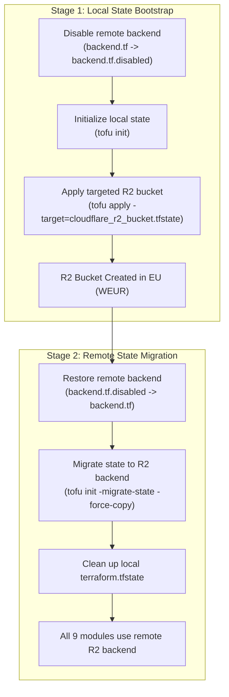

# Infrastructure as Code (IaC) Architecture

This directory houses declarative OpenTofu configurations managing cloud and on-premises infrastructure for the homelab environment.

---

## 🏛️ Architecture Overview

The infrastructure is decomposed into modular, isolated domains to enforce least-privilege access, prevent blast radius propagation, and maintain clean separation of concerns:

| Module                      | Target Platform              | Purpose & Managed Resources                                                                                                                                                                        |
| --------------------------- | ---------------------------- | -------------------------------------------------------------------------------------------------------------------------------------------------------------------------------------------------- |
| [`cloudflare`](cloudflare/) | Cloudflare (Edge & Storage)  | Account settings, Zero Trust baseline, notifications, frozen IAM docs, R2 (incl. **State Storage Bucket** `homelab-infra-tfstate`), and per-zone DNS/settings/Email Routing/WAF via `modules/zone` |
| [`oci`](oci/)               | Oracle Cloud (OCI Free Tier) | Free-tier Ampere A1 (ARM64) and AMD E2.1 compute instances, VCN, subnet, security groups, and Tailscale mesh                                                                                       |
| [`homelab`](homelab/)       | Proxmox VE (On-Premises)     | Placeholder module (0 managed resources until Proxmox VE VMs/LXC containers are added; excluded from drift detection)                                                                              |
| [`gcp`](gcp/)               | Google Cloud Platform        | GCP project baseline, service accounts, and Always Free cloud services                                                                                                                             |
| [`azure`](azure/)           | Microsoft Azure              | Azure resource groups and boundary identities                                                                                                                                                      |
| [`github`](github/)         | GitHub                       | Repository security settings, branch protection rules, environments, and secrets management                                                                                                        |
| [`monitoring`](monitoring/) | Healthchecks.io              | Declarative cron job monitoring checks and notification alerting channels                                                                                                                          |
| [`mesh`](mesh/)             | Tailscale                    | Declarative tailnet ACL policy, MagicDNS preferences, tailnet security settings, admin contacts, and bootstrap auth keys                                                                           |
| [`dns`](dns/)               | NextDNS                      | Multi-account NextDNS profile settings, security posture, privacy blocklists, parental control, allowlist/denylist, and split-horizon DNS rewrites via `modules/profile`                           |

Each module maintains its own state file in the central remote storage backend:
`homelab-infra/state/<module>/tofu.tfstate`

---

## 🔄 The Bootstrap Paradox & Pattern A

### The "Chicken-and-Egg" Problem

OpenTofu relies on a remote S3-compatible backend (Cloudflare R2) to store state files and coordinate distributed locks. However, the Cloudflare R2 bucket itself (`homelab-infra-tfstate`) is declared as code within [`infrastructure/cloudflare/r2.tf`](cloudflare/r2.tf).

If the R2 backend is enabled before the bucket exists, OpenTofu fails on `tofu init` because it cannot reach or create the remote state storage. Conversely, creating the bucket manually out-of-band violates IaC principles, causing configuration drift and loss of provenance.

### Solution: Pattern A (Two-Stage Local-to-Remote State Migration)

We implement **Pattern A**, a two-stage migration workflow:



1. **Stage 1 (Local State Bootstrap):**
   - The remote backend configuration in `infrastructure/cloudflare` is temporarily disabled.
   - OpenTofu initializes with the default `local` backend.
   - A targeted apply is executed (`tofu apply -target=cloudflare_r2_bucket.tfstate`), provisioning the bucket in Cloudflare R2 with European data residency (`location = "WEUR"`).
2. **Stage 2 (Remote State Migration):**
   - The remote S3 backend configuration is restored.
   - `tofu init -migrate-state -force-copy` runs against the S3 endpoint (`https://<account_id>.r2.cloudflarestorage.com`), securely migrating the local state into R2.
   - Local state files are safely wiped from disk.
3. **Subsequent Operations:**
   - All modules (`cloudflare`, `oci`, `homelab`, `gcp`, `azure`, `github`, `monitoring`, `mesh`, `dns`) consume the R2 bucket directly using standard OpenTofu workflows.

---

## 🚀 Execution Guide

### Option 1: Automated Bootstrap (Recommended)

An automated, defensive script is provided to execute Pattern A end-to-end:

```bash
# Preview operations in dry-run mode
mise exec -- ./scripts/bootstrap-state-backend.sh --dry-run

# Execute full two-stage bootstrap
mise exec -- ./scripts/bootstrap-state-backend.sh --auto-approve
```

#### Required Environment Variables

```bash
# Cloudflare API (Stage 1)
export CLOUDFLARE_API_TOKEN="<your-cloudflare-api-token>"
export CLOUDFLARE_ACCOUNT_ID="<your-cloudflare-account-id>"
export CLOUDFLARE_ZONE_ID="<your-cloudflare-zone-id>"

# Cloudflare R2 S3-Compatible API (Stage 2)
# Note: AWS_ACCESS_KEY_ID and AWS_SECRET_ACCESS_KEY are auto-resolved from SOPS
# (opentofu.cloudflare_r2_access_key_id and opentofu.cloudflare_r2_secret_access_key)
# if present. Alternatively, they can be explicitly exported in your shell:
export AWS_ACCESS_KEY_ID="<your-r2-access-key-id>"
export AWS_SECRET_ACCESS_KEY="<your-r2-secret-access-key>"

# OpenTofu Client-Side State Encryption Passphrase
# Required: the modules have no default and fail closed without it. scripts/bootstrap-state-backend.sh
# resolves it from SOPS (opentofu.state_encryption_passphrase); for manual runs export it from there:
export TF_VAR_state_encryption_passphrase="$(sops -d --extract '["opentofu"]["state_encryption_passphrase"]' secrets/credentials.sops.yaml)"
```

### 🔑 Cloudflare R2 API Token Setup (Dashboard)

Because OpenTofu remote state backend credentials cannot be evaluated dynamically inside the state itself (the S3 backend block is statically parsed before resources exist), the R2 API token is provisioned out-of-band via the Cloudflare dashboard and stored in the canonical SOPS secret store:

1. Navigate to **Cloudflare Dashboard > R2 > Manage R2 API Tokens**.
2. Click **Create API Token**.
3. Configure Token Permissions:
   - **Permissions:** _Object Read & Write_ (grants bucket item read and write)
   - **Bucket Scope:** Specific bucket (`homelab-infra-tfstate`)
   - **TTL:** Forever (or per rotation schedule)
4. Note the generated **Access Key ID** and **Secret Access Key**.
5. Store credentials in the canonical SOPS production file:
   ```bash
   mise run secret:prod:set "opentofu.cloudflare_r2_access_key_id"
   mise run secret:prod:set "opentofu.cloudflare_r2_secret_access_key"
   ```

Once stored, `./scripts/bootstrap-state-backend.sh` and CI drift detection workflows auto-resolve these credentials from SOPS automatically.

### Option 2: Manual Step-by-Step Execution

If manual execution is preferred:

```bash
cd infrastructure/cloudflare

# --- Stage 1: Local Bootstrap ---
mv backend.tf backend.tf.disabled
mise exec -- tofu init -input=false
mise exec -- tofu apply -target=cloudflare_r2_bucket.tfstate -input=false

# --- Stage 2: Remote State Migration ---
mv backend.tf.disabled backend.tf
mise exec -- tofu init -migrate-state -force-copy -input=false \
  -backend-config="endpoint=https://${CLOUDFLARE_ACCOUNT_ID}.r2.cloudflarestorage.com"

# --- Cleanup ---
rm -f terraform.tfstate terraform.tfstate.backup
```

---

## 🛡️ Cloudflare R2 Configuration & Best Practices

Our remote state backend follows industry-standard cloud engineering and data sovereignty best practices:

### 1. European Data Residency & Sovereignty

- **Location Constraint:** The R2 bucket is provisioned with `location = "WEUR"` (Western Europe) in [`infrastructure/cloudflare/main.tf`](cloudflare/main.tf).
- **R2 Storage Endpoint:** All OpenTofu backends communicate through the R2 endpoint:
  `https://<account_id>.r2.cloudflarestorage.com`
  This guarantees that all state objects, metadata, and backups reside in the Western European region, complying with data privacy requirements.

### 2. Security & Encryption

- **At-Rest Cloud Encryption:** Cloudflare R2 enforces AES-256 encryption on all stored objects by default.
- **Client-Side OpenTofu Encryption:** OpenTofu supports native state encryption (`encryption.tf`) using AES-GCM with keys managed via SOPS. Even in the unlikely event of storage bucket compromise, raw state values (passwords, tokens, private keys) remain cryptographically shielded.
- **Zero Plaintext Secrets:** Sensitive variables (API tokens, account IDs, zone IDs) are flagged with `sensitive = true` in OpenTofu variable declarations and sourced strictly from encrypted SOPS files (`secrets/credentials.sops.yaml`) or CI secrets.

### 3. Reliability & Distributed Locking

- **Native S3 Lockfile (`use_lockfile = true`):** OpenTofu 1.7+ supports native distributed locking on S3-compatible backends using a lockfile (`.tflock`) stored alongside the state object. This eliminates the need for an external lock provider (such as AWS DynamoDB) while preventing concurrent apply collisions.
- **Compatibility Flags:** To ensure optimal reliability with Cloudflare R2's S3 API:
  - `use_path_style = true`
  - `skip_credentials_validation = true`
  - `skip_region_validation = true`
  - `skip_requesting_account_id = true`
  - `skip_s3_checksum = true`

### 4. Performance & Scalability

- **Partitioned State Hierarchy:** Independent state paths prevent monolithic locking and ensure high-speed operations:
  ```text
  homelab-infra-tfstate/
  └── homelab-infra/
      └── state/
          ├── azure/tofu.tfstate
          ├── cloudflare/tofu.tfstate
          ├── dns/tofu.tfstate
          ├── gcp/tofu.tfstate
          ├── github/tofu.tfstate
          ├── homelab/tofu.tfstate
          ├── mesh/tofu.tfstate
          ├── monitoring/tofu.tfstate
          └── oci/tofu.tfstate
  ```
- **Zero Egress Fees:** Cloudflare R2 charges zero data egress fees, making frequent state reads, CI checks, and plan validations cost-effective.

---

## 🔍 Dynamic Inventory & State Encryption

Ansible dynamically discovers OCI compute instances and networking details using the [`configuration/inventories/oci.terraform_state.yml`](../configuration/inventories/oci.terraform_state.yml) plugin:

- **State Encryption at Rest:** The OCI state file read by Ansible resides encrypted in Cloudflare R2.
- **Transit Security:** State queries are encrypted in transit via TLS 1.3.
- **Dynamic In-Memory Synthesis:** The inventory plugin parses state data in memory during playbook execution to compose MagicDNS FQDNs and Tailscale IPs. Unencrypted network topology or host details are never written to static files on disk.
- **Credential Separation:** The dynamic inventory plugin retrieves R2 S3 access keys and secrets dynamically, keeping all credentials protected in SOPS.

---

## 🔧 Disaster Recovery & State Unlocking

If an OpenTofu operation is interrupted, a state lock may linger in the R2 bucket:

```bash
# Error: Error acquiring the state lock
# Lock Info:
#   ID:        <lock-id>
#   Path:      homelab-infra/state/<module>/tofu.tfstate.tflock
#   Who:       runner@ci
```

To force-unlock the state after confirming no concurrent process is executing:

```bash
mise exec -- tofu -chdir="infrastructure/<module>" force-unlock <lock-id>
```
